<div align="center">

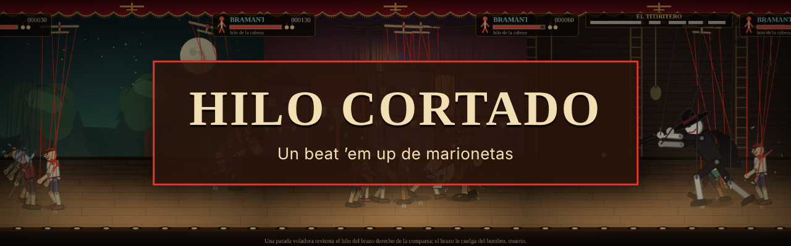

# 🪢 Hilo Cortado

**Beat 'em up de avance lateral con marionetas de madera.**
Cada golpe gasta un hilo: corta los de los brazos y el enemigo suelta el arma, corta el de la cabeza y se desploma en un montón de tablas.

[](https://ivanchux.github.io/hilo-cortado/)


</div>

---

## 📑 Índice

[Qué es](#-qué-es) · [Capturas](#-capturas) · [En movimiento](#-en-movimiento) · [La idea](#-la-idea) · [Controles](#️-controles) · [Los hilos](#-los-hilos) · [Reparto](#-reparto) · [Actos](#-actos) · [Ejecutar y publicar](#-ejecutar-y-publicar) · [Cómo está hecho](#-cómo-está-hecho) · [Pruebas hechas](#-pruebas-hechas) · [Estructura](#-estructura-del-repositorio) · [Licencia](#-licencia)

## 🪢 Qué es

Hilo Cortado es un juego de navegador de peleas de avance lateral para uno o dos jugadores. Los personajes son marionetas de piezas recortadas que cuelgan de una cruceta, y los golpes cortan hilos: sin un brazo no hay golpes con ese brazo, sin una pierna la marioneta cojea y sin el hilo de la cabeza se desploma.

- **Un solo `index.html`**, con Canvas 2D y Web Audio. Sin librerías, sin imágenes y sin sonidos externos.
- Funciona con **teclado, mando y pantalla táctil**.
- **Cooperativo local:** el jugador 2 entra en cualquier momento pulsando su botón de golpe.
- Tres actos, tres jefes y armas que se recogen y se rompen.

## 📸 Capturas

<div align="center">

| Título | Dos jugadores |
|:---:|:---:|
| 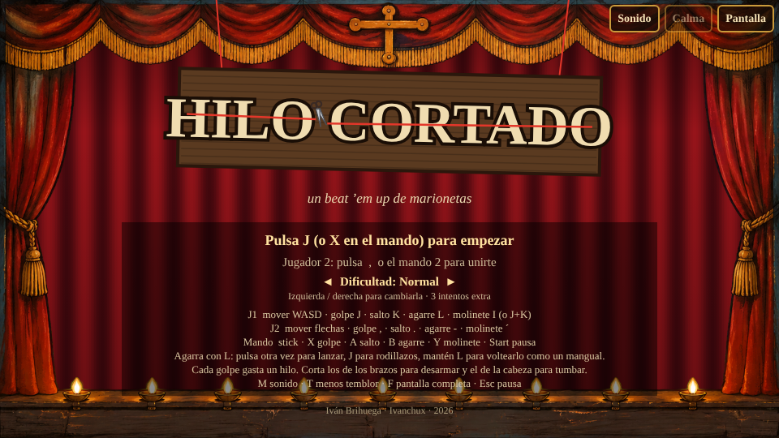 | 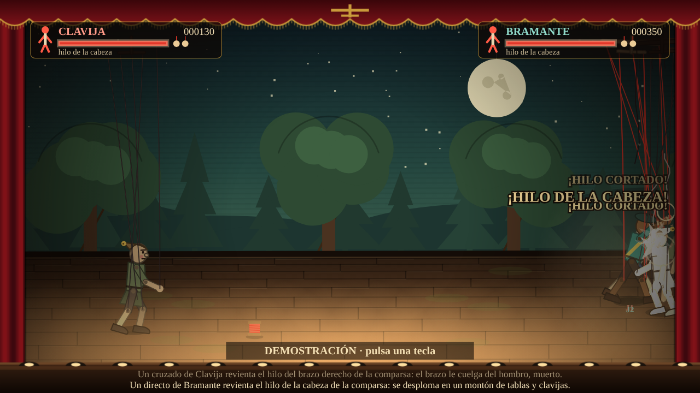 |

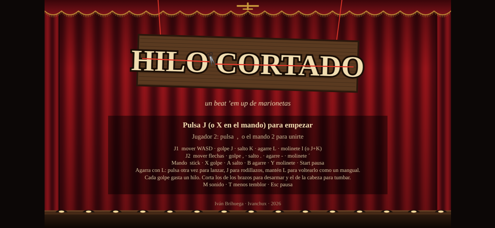 &nbsp; 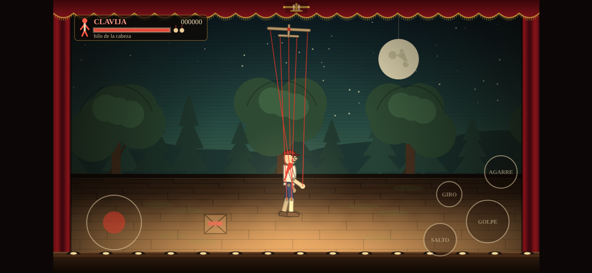

*En el móvil aparece una palanca a la izquierda y cuatro botones a la derecha (solo jugador 1).*

</div>

## 🎬 En movimiento

<div align="center">

**Clavija agarra a un alabardero por los hilos y lo voltea contra el resto**

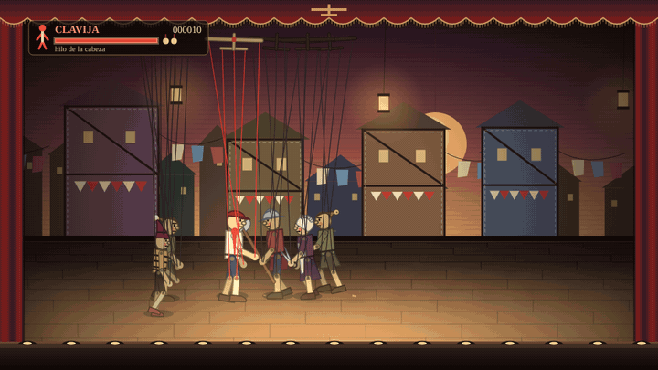

**Cooperativo a dos jugadores**

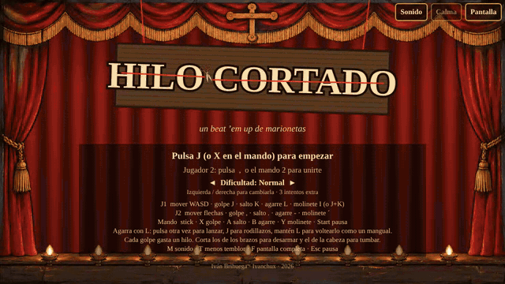

### 📱 En el móvil, con los controles táctiles

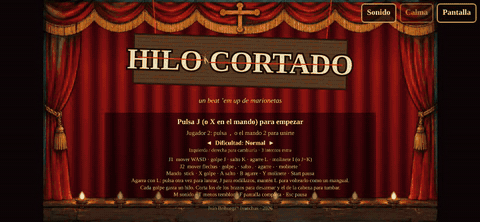

### 🖥️ En el PC

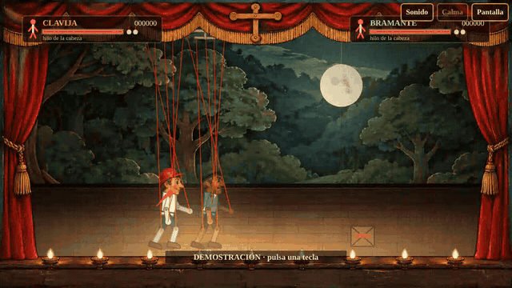

*Los GIF de PC son la demostración del propio juego (`index.html?demo=1`), con dos bots.*

</div>

## 🎭 La idea

Un teatro ambulante y un titiritero que no suelta a nadie. Clavija y Bramante se cortaron los hilos negros con unas tijeras de sastre, se ataron hilo rojo a una cruceta robada y cruzan el decorado, acto por acto, hasta el telar donde él espera.

Los personajes no tienen sprites. Son marionetas de piezas recortadas cuyas poses se interpolan por código, cuelgan de una cruceta que se ve en lo alto del escenario y caen de verdad cuando se les corta un hilo.

## ⌨️ Controles

| Acción | Jugador 1 | Jugador 2 | Mando |
|---|---|---|---|
| Moverse | W A S D | Flechas | Stick o cruceta |
| Golpe | J | , | X / Cuadrado |
| Salto | K | . | A / Cruz |
| Agarre | L | - | B / Círculo (o RB / RT) |
| Molinete | I (o J + K) | ´ (o Numpad 5) | Y / Triángulo |
| Pausa | Esc o P | | Start |

El jugador 2 entra en cualquier momento pulsando su botón de golpe. M quita el sonido y T reduce el temblor de pantalla y los destellos. En pantallas táctiles aparece una palanca a la izquierda y cuatro botones a la derecha (solo jugador 1).

**Golpes.** Cuatro golpes seguidos: directo, cruzado, patada baja y cabezazo que derriba. La patada y el cabezazo solo salen si el golpe anterior ha entrado. Golpe con la dirección contraria: codazo hacia atrás. Doble toque de dirección para correr y golpe en carrera para el hombrazo. Golpe en el aire: patada voladora. El molinete gira la marioneta sobre sus hilos y golpea alrededor a cambio de un poco del hilo de la cabeza.

**Agarres.** L agarra al enemigo que tienes delante. Con él agarrado: J da rodillazos (al tercero lo lanzas), otra pulsación de L lo lanza y **mantener L lo voltea por los hilos como un mangual**; al soltar sale despedido. Los mozos de tramoya pesan demasiado para agarrarlos salvo que estén mareados, y aun así no se pueden voltear. Si un mozo te agarra a ti, machaca botones para soltarte.

**Armas.** Se recogen con golpe o agarre encima de ellas y se lanzan con agarre. Las tijeras multiplican el daño sobre los hilos, la alabarda tiene alcance, el mazo derriba y la vela prende fuego. Cada arma se gasta y se rompe.

## 🧵 Los hilos

Cada marioneta cuelga de cinco hilos: cabeza, dos brazos y dos piernas. Los golpes altos gastan el hilo de un brazo y algo de la cabeza; los bajos, el de una pierna; los cabezazos, el de la cabeza directamente.

- **Brazo cortado:** cuelga del hombro. Si era el del arma, el enemigo la suelta y la puedes recoger. Sin el brazo derecho no hay golpes con ese brazo; sin los dos solo quedan patadas.
- **Pierna cortada:** la marioneta cojea y va más lenta. Sin las dos, arrastra los zuecos y no puede saltar.
- **Cabeza cortada, o los cuatro miembros:** se desploma.

Los jugadores funcionan igual. Un carrete de hilo rojo vuelve a atar el hilo más gastado y un ovillo los ata todos. El fuego de la vela va quemando hilos mientras dura, y un enemigo en llamas que lanzas o volteas prende a los que golpea.

Los jefes pierden ataques al perder hilos: al Titiritero, sin el brazo del bastón, se le acaba el barrido; sin el izquierdo, el tirón de hilos; sin piernas, el pisotón.

## 🎎 Reparto

| Marioneta | Qué hace |
|---|---|
| Clavija | Jugador 1. Pino claro, pañuelo rojo |
| Bramante | Jugador 2. Nogal, faja amarilla y boina |
| Comparsa | Puñetazos y cruzados. El grueso de la compañía |
| Alabardero | Guarda la distancia y ataca con la alabarda desde lejos |
| Saltimbanqui | Rápido y frágil. Entra con una patada en voltereta y esquiva con un salto atrás |
| Costurera | Sus tijeras cortan hilos al doble. Conviene desarmarla la primera |
| Mozo de tramoya | Grande y pesado. No se inmuta con golpes flojos mientras prepara el mazazo y agarra |
| El Mozo Mayor | Jefe del acto I. Mazazos, agarres y embestidas que acaban contra el bastidor |
| La Madre Tijera | Jefa del acto II. Combos de tijerona, caídas desde arriba y tijeras que vuelven a su mano |
| El Titiritero | Jefe final. Barre con el bastón, pisa con onda, engancha con hilo negro, baja comparsas y deja caer tijeras del telar |

## 🎪 Actos

| Acto | Decorado | Qué cambia |
|---|---|---|
| I · El Bosque Pintado | Árboles de cartón sobre ruedas y una luna colgada de un hilo | Un solo enemigo ataca a la vez sobre cada jugador. Comparsas y alabarderos |
| II · La Ciudad de Tela | Casas de retales cosidos, tendederos y farolillos | Dos atacantes por jugador. Entran saltimbanquis, costureras y un mozo |
| III · El Castillo de Tramoya | Muros pintados, estandartes, sacos de contrapeso y poleas; al final, el telar desnudo | Ritmo más alto y más daño. Mozos en pareja y velas para prender fuego |

<div align="center">

| Acto I | Acto II |
|:---:|:---:|
| 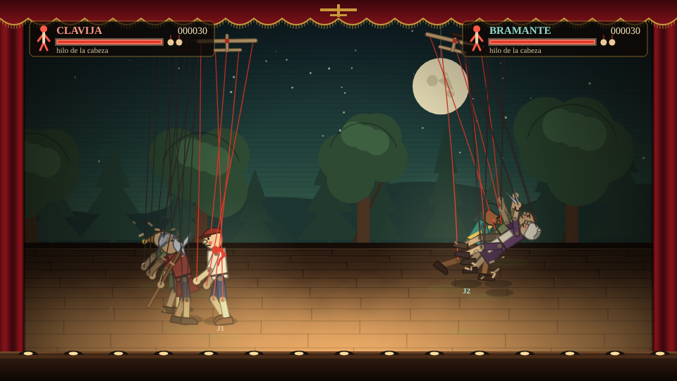 | 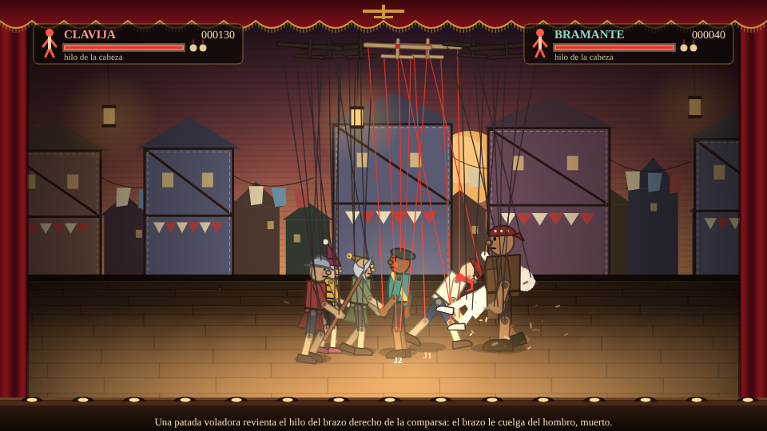 |

| Acto III | El Titiritero |
|:---:|:---:|
| 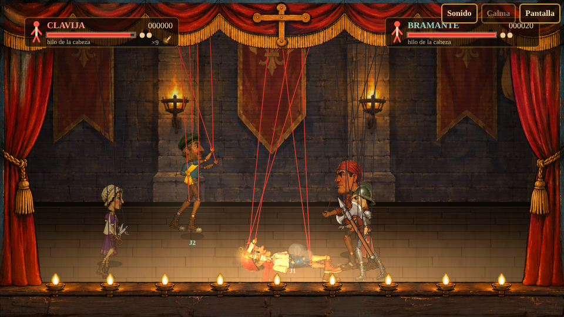 | 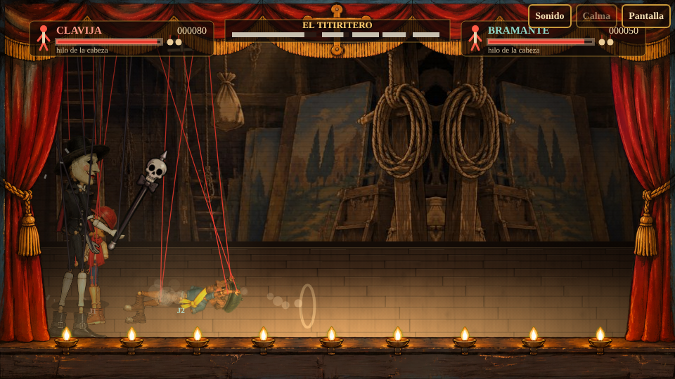 |

</div>

## 🚀 Ejecutar y publicar

### Jugar en local

No hace falta instalar nada. Abre `index.html` en el navegador.

```bash
git clone https://github.com/Ivanchux/hilo-cortado.git
cd hilo-cortado
# abre index.html, o sirve la carpeta si prefieres:
python3 -m http.server 8000   # http://localhost:8000
```

### Publicar en GitHub Pages

1. Sube el repositorio a GitHub.
2. Ve a **Settings → Pages**.
3. En *Build and deployment* elige **Deploy from a branch**, rama `main` y carpeta `/ (root)`.
4. En un minuto estará en `https://ivanchux.github.io/hilo-cortado/`.


## 🔧 Cómo está hecho

- **Un solo `index.html`** de unas 2 750 líneas, con Canvas 2D y Web Audio. Sin librerías, sin imágenes y sin sonidos externos.
- **Animación procedural por esqueleto.** Cada marioneta tiene diez articulaciones y una raíz. Los estados (andar, golpear, caer, agarrar…) dan poses clave y cada articulación las persigue con un muelle amortiguado, lo que da el balanceo de marioneta sin fotogramas dibujados. Un miembro sin hilo deja de seguir la pose y pasa a colgar como un péndulo que reacciona a la aceleración del cuerpo. Al morir, el esqueleto se convierte en un muñeco de Verlet que se desploma sobre las tablas. Las crucetas siguen a cada marioneta con inercia y los hilos se inclinan cuando corre o sale despedida.
- **Combate.** Cajas de golpe y de daño en tres ejes (avance, altura y profundidad), parada de fotogramas por golpe, empuje, malabares limitados en el aire, mareo acumulado y supercoraza en los ataques pesados. Un director de turnos reparte los ataques: solo quien tiene turno puede golpear y el resto rodea al jugador.
- **Juice.** Parada de fotogramas, temblor por trauma, destello blanco del golpeado, astillas, chispas, polvo, hilos que salen latigueando hacia arriba al cortarse, cámara lenta al caer un jefe y texto de combate concreto en la parte baja del escenario («Las tijeras de la costurera cortan el hilo de la pierna derecha de Clavija: la pierna se le dobla y cojea.»).
- **Sonido.** Todo sintetizado. Los hilos que se rompen y la música de feria salen de cuerdas pulsadas con Karplus-Strong; los golpes, de osciladores y ruido filtrado.
- **Pruebas.** `index.html?test=1` expone `window.HC` para jugar sin interfaz: arrancar partidas con semilla, avanzar fotogramas, colocar enemigos, pulsar botones y leer estadísticas. `index.html?demo=1` arranca la demostración con dos bots, que también salta sola tras 25 segundos en el título.

## 🧪 Pruebas hechas

En Chromium sin interfaz, con Playwright:

- 21 pruebas guiadas de mecánicas: combo de cuatro golpes, agarre, rodillazos, lanzamiento contra otro enemigo, mangual con varios impactos, mozo que no se deja agarrar, recoger tijeras y cortar, desarmar y recoger la alabarda caída, mazo lanzado, molinete, patada voladora, codazo, hombrazo, vela que quema hilos, agarre automático al mareado, agarre del mozo y escape machacando botones.
- 6 partidas completas de los tres actos con bots. A dos jugadores, las tres llegan al final con dos continuaciones en unos 16 minutos. A un jugador tardan entre 19 y 24 minutos y necesitan de tres a cinco continuaciones: con las tres que da el juego, solo una de las tres partidas llega al final.
- 40 combates de un minuto con los cinco tipos de enemigo: 7 092 golpes, 1 845 hilos cortados, 539 marionetas tumbadas, ningún ataque sin turno, nunca más atacantes que turnos, sin valores NaN ni marionetas atascadas.
- La simulación es determinista con la misma semilla.
- Sin errores de consola, con sonido y con entrada táctil simulada.


## 📁 Estructura del repositorio

```text
hilo-cortado/
├── index.html        # El juego completo (HTML + CSS + JS)
├── capturas/         # Banner, capturas y GIFs de este README
├── CHANGELOG.md      # Historial de versiones
├── LICENSE           # PolyForm Noncommercial 1.0.0
└── README.md
```

## 🗺️ Ideas futuras

- [ ] Probar con mandos reales, Firefox, Safari y móviles
- [ ] Ajustar la dificultad jugando con personas
- [ ] Guardar récords en el navegador

## 📜 Licencia

El código está bajo **[PolyForm Noncommercial 1.0.0](LICENSE)**.

**Puedes, sin pedir permiso:**
- Jugarlo y compartir el enlace.
- Estudiar el código y modificarlo para uso personal, educativo o sin ánimo de lucro.
- Subirlo a otra web o a tu propio hosting, siempre gratis y sin anuncios, conservando el aviso de copyright y la licencia.
- Hacer streams, vídeos y capturas del juego, aunque tu canal esté monetizado.

**Necesitas mi permiso por escrito para:**
- Vender el juego, una copia o una versión modificada.
- Publicarlo en tiendas de aplicaciones o plataformas de juegos.
- Incluirlo en una web con anuncios, suscripciones o compras.

---

<div align="center">

Hecho con 🪢 por **[Ivanchux](https://github.com/Ivanchux)**

⭐ Si te ha gustado, deja una estrella al repositorio.

</div>
